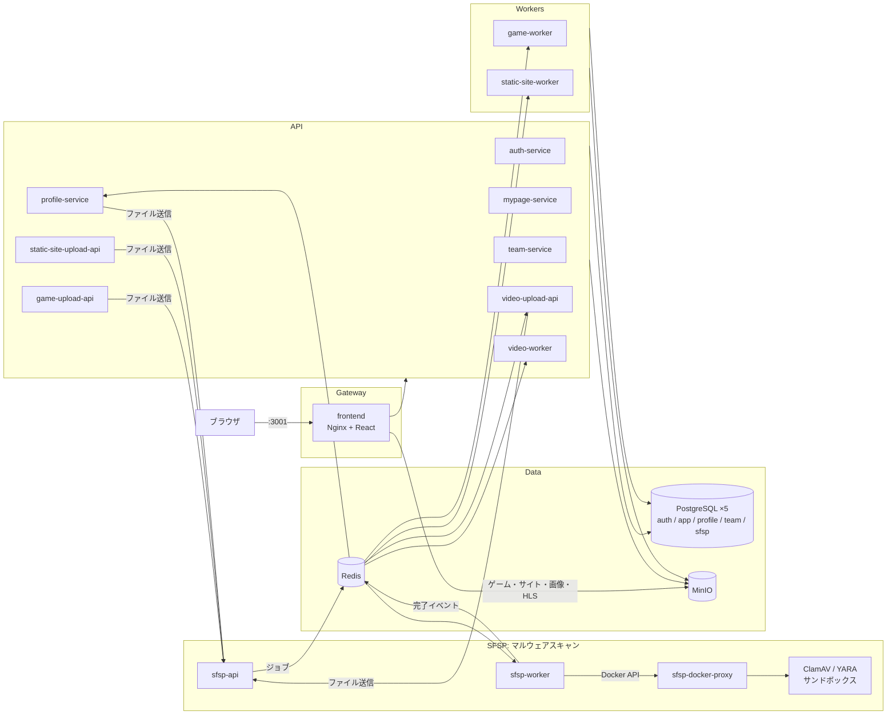
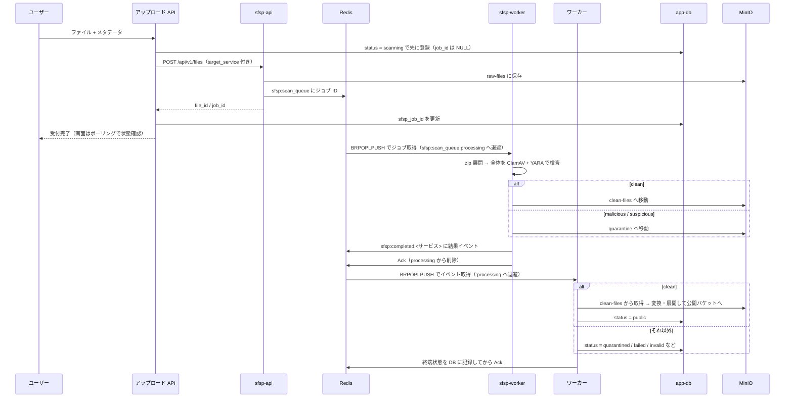

# Atomosidea

動画・Unity WebGL ゲーム・静的サイトをアップロードして公開できる、マイクロサービス構成のコンテンツプラットフォームです。
アップロードされたファイルはすべてマルウェアスキャン（SFSP）を通過してから公開されます。

> イメージとしては **YouTube（動画）＋ itch.io（ゲーム）＋ GitHub Pages（静的サイト）** を 1 つにまとめたものです。

| 目的 | 読むもの |
|---|---|
| とりあえず動かしたい | [クイックスタート](#クイックスタート) |
| 全体の仕組みを知りたい | [アーキテクチャ](#アーキテクチャ) |
| API を調べたい | [API 一覧](#api-一覧) |
| AI にコードを変更させたい | [`EditAI.md`](EditAI.md)（AI 向けの詳細仕様） |
| セキュリティ設計を知りたい | [`SECURITY_EXPLANATION.md`](SECURITY_EXPLANATION.md) |

---

## 目次

1. [主な機能](#主な機能)
2. [クイックスタート](#クイックスタート)
3. [アーキテクチャ](#アーキテクチャ)
4. [サービス一覧](#サービス一覧)
5. [アップロードから公開までの流れ](#アップロードから公開までの流れ)
6. [データとストレージ](#データとストレージ)
7. [API 一覧](#api-一覧)
8. [ディレクトリ構成](#ディレクトリ構成)
9. [管理用スクリプト](#管理用スクリプト)
10. [セキュリティ](#セキュリティ)
11. [トラブルシューティング](#トラブルシューティング)
12. [開発規約](#開発規約)
13. [関連ドキュメント](#関連ドキュメント)

---

## 主な機能

| 機能 | 内容 |
|---|---|
| **動画** | アップロードした動画を 360p / 480p / 720p / 1080p の HLS に変換して配信（hls.js で再生） |
| **ゲーム** | Unity WebGL ビルドの zip を展開し、ゲームごとのサブドメイン（`<id>.localhost`）で配信。表示倍率・位置の調整も可能 |
| **静的サイト** | HTML/CSS/JS の zip を展開し、サイトごとのサブドメインで配信 |
| **プロフィール** | ユーザー名・自己紹介・アイコン・背景画像（画像もスキャンしてから反映） |
| **マイページ** | 自分が投稿した動画・ゲーム・静的サイトの一覧と編集・削除 |
| **チーム** | Discord の招待リンクのような、URL（トークン）ベースのグループ。チーム限定公開のコンテンツや投稿を共有 |
| **認証** | Google OAuth2（一般ユーザー）と、管理者コードによるローカル管理者アカウント |
| **マルウェアスキャン** | すべてのアップロードを ClamAV と YARA で検査（隔離されたサンドボックスで実行） |
| **監視ダッシュボード（開発者用）** | コンテナの状態・リソース・ログ・MinIO の中身をブラウザで確認（HTTP Basic 認証あり） |

---

## クイックスタート

### 必要なもの

- Docker Desktop（Docker Compose v2 を含む）

### 1. 環境変数を用意する

```bash
cp .env.example .env
```

`.env` を開き、少なくとも次の値を自分用の値に変更してください（そのままでもローカルでは動きますが、例の値は公開されています）。`setup.bat` を使う場合は、Google の認証情報を入力するだけで、パスワード・鍵類は乱数で自動生成されます。

| 変数 | 内容 |
|---|---|
| `POSTGRES_PASSWORD`、`*_DB_PASSWORD` | 各 DB のパスワード（`*_DB_PASSWORD` はサービス専用ロールの分。`db-role-init` が起動のたびに DB へ反映） |
| `JWT_SECRET` | JWT の署名鍵（十分に長いランダム文字列） |
| `ADMIN_REGISTRATION_CODE` | 管理者アカウント登録に必要なコード |
| `REDIS_PASSWORD` | Redis のパスワード（必須。未設定だと compose がエラーにします） |
| `SFSP_API_KEY` | sfsp-api の認証キー（ヘッダー `X-SFSP-API-Key`。必須） |
| `INTERNAL_API_KEY` | サービス間の内部 API の認証キー（ヘッダー `X-Internal-Key`。必須） |
| `MINIO_ROOT_*`、`*_MINIO_*`、`SFSP_*_ACCESS_KEY` / `SFSP_*_SECRET_KEY` | MinIO の root とサービスごとのアクセスキー（`minio-init` が自動でユーザーを作成） |
| `MAX_VIDEO_UPLOAD_BYTES`、`MAX_GAME_UPLOAD_BYTES`、`MAX_SITE_UPLOAD_BYTES`、`MAX_IMAGE_UPLOAD_BYTES` | アップロードサイズの上限（バイト）。超えると 413 |
| `MONITOR_USERNAME` / `MONITOR_PASSWORD` | 監視ダッシュボードのログイン（HTTP Basic）。未設定だとダッシュボードは全リクエストを拒否します |
| `GOOGLE_CLIENT_ID` / `GOOGLE_CLIENT_SECRET` | Google ログインを使う場合のみ。未設定なら Google ログインの API は無効になります |

### 2. 起動する

Windows ではスクリプトを使えます。

| やりたいこと | コマンド |
|---|---|
| 初回セットアップ（`.env` の対話作成 → ビルド → 起動。Google のクライアント ID / シークレットの入力が必要） | `setup.bat` |
| 起動 | `start.bat` |
| 停止 | `stop.bat` |
| コード変更を反映（`git pull` → キャッシュなしで再ビルド → 起動） | `update.bat` |

スクリプトを使わない場合:

```bash
docker compose up -d --build
```

### 3. アクセスする

- アプリ: <http://localhost:3001>
- ログ: `docker compose logs -f <サービス名>`

### 4. 最初の管理者でログインする

初期データの管理者アカウントはありません。次の手順で管理者アカウントを作ってください（以前のバージョンで作った DB に `admin@internal.local` が残っている場合は、`EditAI.md` 5.1 の SQL で削除してください）。

1. 「新規登録」→「管理者として登録」を開く
2. メールアドレス・パスワード（8 文字以上）・`ADMIN_REGISTRATION_CODE` を入力して登録
3. 作成したアカウントでログイン

### 5. （任意）監視ダッシュボードを起動する

```bash
cd monitoring-service
docker compose --env-file ../.env -f docker-compose.monitoring.yml up -d --build
```

<http://localhost:8090> で開き、`.env` の `MONITOR_USERNAME` / `MONITOR_PASSWORD` でログインします（HTTP Basic 認証。`--env-file ../.env` を付けないと資格情報が渡らず 503 になります。Windows では `monitoring-service\scripts\start.bat` が自動で付けます）。コンテナの再起動や MinIO の操作ができる強い権限を持つため、Basic 認証に加えて**ホストのループバック（127.0.0.1）にのみ公開**しています。

---

## アーキテクチャ

すべてのサービスは Docker Compose で動き、入口は `frontend` コンテナの Nginx 1 つだけです（メインの compose でホストに公開されるのはポート 3001 のみ。監視ダッシュボードは別 compose で `127.0.0.1:8090`）。



### 設計のポイント

- **機能ごとに独立したサービス**: 重い処理（動画変換など）だけを個別にスケールでき、1 つのサービスが落ちても他は動き続けます。
- **非同期処理**: アップロード API はファイルを SFSP に渡して即座に応答し、スキャン・変換・展開は Redis のキュー経由でワーカーが処理します。
- **公開前に必ずスキャン**: どのアップロードも SFSP で `clean` と判定されたものだけが公開されます。
- **ユーザーのコンテンツは別オリジンで配信**: ゲームと静的サイトは `<id>.localhost` のサブドメインで配信し、アプリ本体（JWT を保存している `localhost`）とオリジンを分けています。

### ネットワーク

| ネットワーク | 主な参加者 | 役割 |
|---|---|---|
| `atmosidea-network` | frontend、各 API / ワーカー、Redis、MinIO、minio-init | アプリ全体の通信。**外向き通信ができる唯一のネットワーク**（Google OAuth など） |
| `backend-db-network`（`internal: true`） | auth-db、app-db、profile-db、team-db、db-role-init と、それを使うサービス（sfsp-worker は app-db の読み取り用） | アプリ用 DB 接続 |
| `sfsp-isolated-net`（`internal: true`） | sfsp-api、sfsp-worker、Redis、MinIO、minio-init、各アップロード API / ワーカー、profile-service | SFSP 関連の通信 |
| `sfsp-db-network`（`internal: true`） | sfsp-db、sfsp-api、sfsp-worker のみ | sfsp-db 専用 |
| `sfsp-docker-net`（`internal: true`） | sfsp-docker-proxy、sfsp-worker のみ | スキャナー起動用の Docker API プロキシ専用 |

`internal: true` のネットワークは外部に出られません。ネットワーク定義を変えた後は `docker compose down` → `up -d` で作り直してください（そのままだと「network needs to be recreated」で失敗します）。
### 技術スタック

| 分類 | 技術 |
|---|---|
| フロントエンド | React、Vite、TypeScript、MUI、Axios、React Router、hls.js、jwt-decode、react-image-crop |
| バックエンド | Go 1.25、Gin（監視サービスは gorilla/mux）、pgx/v5、minio-go/v7、go-redis/v8、golang-jwt/v5 |
| データ | PostgreSQL 16、Redis 7、MinIO（S3 互換） |
| セキュリティ | ClamAV、YARA（Docker サンドボックスで実行） |
| 動画処理 | FFmpeg |
| 実行環境 | Docker、Docker Compose |

---

## サービス一覧

| サービス | ポート（内部） | 役割 | 実装 |
|---|---|---|---|
| `frontend` | 80（ホスト 3001） | React の配信と API ゲートウェイ（Nginx） | `frontend/` |
| `auth-service` | 8080 | ログイン、Google OAuth（ワンタイムコードの交換）、JWT 発行、ログアウト、アカウント削除 | `backend/auth/auth-worker/` |
| `profile-service` | 8084 | プロフィール管理、アイコン・背景画像のスキャン依頼と反映 | `backend/profile-service/profile-worker/` |
| `mypage-service` | 8083 | 自分の投稿一覧 | `backend/profile-service/mypage-worker/` |
| `team-service` | 8080 | チーム・メンバー・加入申請・チーム内投稿 | `backend/team-service/team-worker/` |
| `video-upload-api` | 8080 | 動画アップロード受付、**スキャン後の HLS 変換**、動画削除 | `backend/video-service/video-upload-api/` |
| `video-worker` | 8081 | 動画の一覧・詳細・編集 API、サムネイル差し替えの反映 | `backend/video-service/video-worker/` |
| `game-upload-api` | 8082 | ゲームのアップロード・一覧・詳細・編集・削除 | `backend/game-service/game-upload-api/` |
| `game-worker` | — | スキャン済みゲーム zip の展開・解像度抽出・配置 | `backend/game-service/game-worker/` |
| `static-site-upload-api` | 8085 | 静的サイトのアップロード・一覧・詳細・編集・削除 | `backend/static-site-service/static-site-upload-api/` |
| `static-site-worker` | — | スキャン済みサイト zip の展開・配置 | `backend/static-site-service/static-site-worker/` |
| `sfsp-api` | 8080 | スキャン対象ファイルの受付とジョブ登録（`X-SFSP-API-Key` 必須） | `backend/security/sfsp/` |
| `sfsp-worker` | — | ClamAV / YARA をサンドボックスで実行し、結果を各サービスへ通知（Docker 操作は `sfsp-docker-proxy` 経由） | `backend/security/sfsp/` |
| `sfsp-docker-proxy` | 2375 | sfsp-worker 専用の Docker API プロキシ（コンテナの作成・起動・削除など必要な API だけ許可） | `tecnativa/docker-socket-proxy`（compose で定義） |
| `sfsp-clamav-client` / `sfsp-yara-client` | — | スキャナーのイメージをビルドするだけのサービス | `backend/security/sfsp/docker/` |
| `auth-db` / `app-db` / `profile-db` / `team-db` / `sfsp-db` | 5432 | PostgreSQL | 各 `init.sql` |
| `db-role-init` | — | 起動のたびに 1 回だけ動き、`.env` の値で DB ロールのパスワードを設定 | `backend/db-init/sync-role-passwords.sh` |
| `redis` | 6379 | ジョブキュー、JWT ブロックリスト、OAuth ワンタイムコード（パスワード必須） | — |
| `minio` / `minio-init` | 9000 | オブジェクトストレージ／バケット・ユーザー・ポリシーの初期化 | `backend/minio-init/` |

監視ダッシュボード（`mon-nginx` / `mon-backend` / `mon-frontend`）は別の compose ファイル（`monitoring-service/docker-compose.monitoring.yml`）で起動します（`mon-nginx` はホストの `127.0.0.1:8090` に公開）。

---

## アップロードから公開までの流れ

ゲーム・静的サイト・動画・プロフィール画像は、どれも同じ流れで処理されます。



- アップロード API は、SFSP に送る**前に** DB の行を `scanning` で作り、送信に失敗したら行を削除します。
- Redis からの取り出しは `BRPOPLPUSH` + `Ack` です。処理途中で落ちても、起動時に `<キュー>:processing` に残ったメッセージを元のキューに戻して再処理します。
- 図の DB は、動画・ゲーム・静的サイトでは `app-db`、プロフィール画像では `profile-db` です。

| コンテンツ | 結果イベントのキュー | 処理するサービス | 処理内容 |
|---|---|---|---|
| 動画 | `sfsp:completed:stream` | `video-upload-api` | FFmpeg で HLS（4 解像度）とサムネイルを作成し `videos` バケットへ |
| ゲーム | `sfsp:completed:game` | `game-worker` | zip を展開し、`index.html` から解像度を抽出、CSS を注入して `games` バケットへ |
| 静的サイト | `sfsp:completed:static-site` | `static-site-worker` | zip を展開して `static-sites` バケットへ |
| プロフィール画像 | `sfsp:completed:profile` | `profile-service` | `user-profiles` バケットへ保存し、古い画像を削除 |
| サムネイル | `sfsp:completed:video-thumbnail` / `game-thumbnail` / `site-thumbnail` | `video-worker` / `game-worker` / `static-site-worker` | 画像（jpeg / png / gif / webp）だけを保存 |

---

## データとストレージ

### データベース（PostgreSQL ×5）

| DB | 主なテーブル | 初期化スクリプト |
|---|---|---|
| `auth-db` | `users`（ログイン情報・プロバイダー・管理者フラグ） | `backend/auth/auth-datebase/auth-db/init.sql` |
| `profile-db` | `users`（ユーザー名・自己紹介・画像 URL） | `backend/profile-service/profile-db/init.sql` |
| `app-db` | `videos`、`games`、`static_sites` | `backend/datebase/app-db/*.sql` |
| `team-db` | `teams`、`team_members`、`team_join_requests`、`team_content`、`team_posts` | `backend/team-service/team-db/init.sql` |
| `sfsp-db` | `files`、`scan_jobs`、`scan_results` | `backend/security/sfsp-db/*.sql` |

> `datebase` はタイプミスではなく実際のディレクトリ名です。

各テーブルのカラム定義は [`EditAI.md` のデータベース節](EditAI.md#5-データベース) を参照してください。

### オブジェクトストレージ（MinIO ×1）

MinIO は 1 台で、バケットとサービスごとのユーザーで権限を分けています。データはホストの `backend/storage_data/` に保存されます。

| バケット | 中身 | 公開 |
|---|---|---|
| `videos` | HLS（`<id>/...`）、サムネイル（`thumbnails/<id>`） | 匿名ダウンロード可 |
| `games` | ゲーム本体（`<id>/...`）、サムネイル（`thumbnails/<id>`） | 匿名ダウンロード可 |
| `static-sites` | サイト本体（`<id>/...`）、サムネイル（`thumbnails/...`） | 匿名ダウンロード可 |
| `user-profiles` | アイコン（`icons/`）、背景（`backgrounds/`） | 匿名ダウンロード可 |
| `raw-files` | スキャン前のファイル | 非公開 |
| `clean-files` | スキャンで問題なしと判定されたファイル | 非公開 |
| `quarantine` | マルウェアの疑いがあるファイル | 非公開 |

### Redis

| キー | 用途 |
|---|---|
| `sfsp:scan_queue` | スキャン待ちのジョブ ID |
| `sfsp:completed:*` | スキャン結果イベント（上の表を参照） |
| `<キュー名>:processing` | 取り出し済み・処理中のメッセージ（`Ack` で削除、起動時に元のキューへ戻す） |
| `sfsp:scan_queue:dead` | 5 回失敗したスキャンジョブ（手動確認用） |
| `blocklist:<jti>` | ログアウト済み JWT（有効期限まで保持。JWT を検証する全サービスが確認） |
| `oauth_code:<code>` | Google ログイン後のワンタイムコード（60 秒・1 回限り） |

Redis は `REDIS_PASSWORD` によるパスワード必須の設定で、ホストには公開していません。

---

## API 一覧

すべて `http://localhost:3001` 経由でアクセスします。「認証」が JWT のものは `Authorization: Bearer <token>` が必要です。

### 認証 — `/api/auth`（auth-service）

| メソッド | パス | 認証 | 説明 |
|---|---|---|---|
| POST | `/register` | 管理者コード | 管理者アカウントを作成。`{"email", "password", "adminCode"}`（パスワードは 8 文字以上、同じメールは 409） |
| POST | `/login` | — | ローカルログイン。`{"email", "password"}` → `{"token"}` |
| GET | `/google/login` | — | Google ログイン開始（Google の認証情報が設定されている場合のみ有効） |
| GET | `/google/callback` | — | Google からのコールバック。成功すると `/login/success?code=...` にリダイレクト（コードは 60 秒・1 回限り。JWT は URL に載せない） |
| POST | `/oauth/exchange` | — | ワンタイムコードを JWT に交換。`{"code"}` → `{"token"}`（無効・期限切れは 401） |
| POST | `/logout` | JWT | トークンを無効化 |
| DELETE | `/me` | JWT | アカウントと投稿コンテンツを削除 |
| GET | `/user/:userId` | — | ユーザーの認証プロバイダー（`local` / `google`） |

### プロフィール — `/api/profile`（profile-service）

| メソッド | パス | 認証 | 説明 |
|---|---|---|---|
| GET | `/me` | JWT | 自分のプロフィール（無ければ自動作成） |
| GET | `/status` | JWT | 自分のアカウント状態 |
| GET | `/:userId` | — | 指定ユーザーの公開プロフィール |
| PUT | （ベースパス） | JWT | ユーザー名・自己紹介の更新。`{"username", "bio"}` |
| PUT | `/icon` | JWT | アイコン更新（multipart `icon`、スキャン後に反映） |
| PUT | `/background` | JWT | 背景画像更新（multipart `background`、スキャン後に反映） |
| POST | `/internal/create`（旧パス） | `X-Internal-Key` | 移行用。Nginx は `/api/profile/internal/` を 404 にするため外部からは届かない |

内部専用の API は `/api/profile` の外にあり、Nginx からは届きません（`X-Internal-Key` が `INTERNAL_API_KEY` と一致しない場合は 403）。

| メソッド | パス | 説明 |
|---|---|---|
| POST | `/internal/create` | auth-service からの初期プロフィール作成。`{"user_id", "username"}` |
| DELETE | `/internal/users/:userId` | アカウント削除時のプロフィール・画像の削除 |

### 動画 — `/api/videos`

| メソッド | パス | 担当 | 認証 | 説明 |
|---|---|---|---|---|
| POST | `/upload` | video-upload-api | JWT | 動画アップロード（multipart `video`、`title`、`description`） |
| DELETE | `/delete/:id` | video-upload-api | JWT（投稿者 / 管理者） | 動画削除（Nginx が `/api/videos/:id` に書き換えて転送） |
| DELETE | `/:id/thumbnail` | video-upload-api | JWT（投稿者 / 管理者） | サムネイル削除 |
| GET | （ベースパス） | video-worker | — | 一覧（`?q=` で検索、`?team=` でチーム限定。公開済みのみ） |
| GET | `/:id` | video-worker | — | 詳細（投稿者・管理者以外は公開済みのみ。チーム限定は閲覧権限が必要） |
| PUT | `/:id` | video-worker | JWT（投稿者 / 管理者） | タイトル・説明・サムネイルの更新 |
| GET | `/:id/stream/<path>` | Nginx → MinIO | — | HLS（`playlist.m3u8` とセグメント） |

### ゲーム — `/api/games`（game-upload-api）

| メソッド | パス | 認証 | 説明 |
|---|---|---|---|
| POST | `/upload` | JWT | ゲームアップロード（multipart `game`、`thumbnail`、`title`、`description`） |
| GET | （ベースパス） | — | 一覧（`?q=` で検索、`?team=` でチーム限定） |
| GET | `/:id` | — | 詳細（投稿者・管理者以外は公開済みのみ。チーム限定は閲覧権限が必要） |
| PUT | `/:id` | JWT | タイトル・説明・サムネイルの更新 |
| PUT | `/adjust/:id` | JWT | 表示調整。`{"scale", "offset_x", "offset_y"}` |
| DELETE | `/:id` | JWT | ゲーム削除 |
| DELETE | `/:id/thumbnail` | JWT | サムネイル削除 |

### 静的サイト — `/api/static-sites`（static-site-upload-api）

| メソッド | パス | 認証 | 説明 |
|---|---|---|---|
| POST | `/upload` | JWT | サイトアップロード（multipart `file`、`thumbnail`、`title`、`description`） |
| GET | （ベースパス） | — | 一覧（`?q=` で検索、`?team=` でチーム限定） |
| GET | `/:id` | — | 詳細（投稿者・管理者以外は公開済みのみ。チーム限定は閲覧権限が必要） |
| PUT | `/:id` | JWT | タイトル・説明の更新 |
| DELETE | `/:id` | JWT | サイト削除 |
| DELETE | `/:id/thumbnail` | JWT | サムネイル削除 |

### マイページ — `/api/my`（mypage-service）

| メソッド | パス | 認証 | 説明 |
|---|---|---|---|
| GET | `/videos` | JWT | 自分の動画 |
| GET | `/games` | JWT | 自分のゲーム |
| GET | `/static-sites` | JWT | 自分の静的サイト |

### チーム — `/api/teams`（team-service）

チームは 24 文字のトークン（URL）で識別します。ロールは `owner` > `admin` > `member` の 3 段階です。

| メソッド | パス | 認証 | 説明 |
|---|---|---|---|
| GET | （ベースパス） | — | 公開チーム一覧 |
| GET | `/mine` | JWT | 自分が参加しているチーム |
| POST | （ベースパス） | JWT | チーム作成。`{"name", "description", "is_public", "auto_approve", "allow_member_invite"}` |
| GET | `/:token` | — | チーム詳細 |
| PATCH | `/:token` | owner | チーム情報の更新 |
| DELETE | `/:token` | owner | チーム削除 |
| GET | `/:token/permission` | — | 呼び出し元の閲覧・投稿権限（各アップロード API が使用） |
| GET | `/:token/members` | member 以上 | メンバー一覧 |
| POST | `/:token/members` | admin 以上 | メンバー追加 |
| DELETE | `/:token/members/:userId` | admin 以上 | メンバー削除 |
| POST | `/:token/join` | JWT | 加入申請（公開チームのみ。`auto_approve` なら即参加） |
| GET | `/:token/join-requests` | admin 以上 | 加入申請一覧 |
| PATCH | `/:token/join-requests/:requestId?action=approve\|reject` | admin 以上 | 加入申請の承認・却下（保留中の申請のみ） |
| DELETE | `/:token/join-requests` | JWT | 自分の加入申請を取り消し |
| POST | `/:token/content` | member 以上 | チーム内投稿の作成。`{"title", "body"}` |
| GET | `/:token/content` | 公開チームは不要 | 投稿一覧 |
| GET | `/:token/content/:contentID` | 同上 | 投稿 1 件 |

### SFSP — `/api/v1`（sfsp-api、内部専用）

Nginx からは公開されておらず、各サービスからのみ呼び出されます。`/api/v1/*` にはヘッダー `X-SFSP-API-Key`（`SFSP_API_KEY` と一致）が必須で、違うと 401 です。

| メソッド | パス | 説明 |
|---|---|---|
| POST | `/api/v1/files` | スキャン依頼（multipart `file`、`target_service`）→ `{"file_id", "job_id", "status"}` |
| GET | `/api/v1/jobs/:id` | ジョブの状態 |
| GET | `/api/v1/results/:id` | スキャン結果 |
| GET | `/health` | ヘルスチェック |

### 監視ダッシュボード — `http://localhost:8090`（mon-backend）

| メソッド | パス | 説明 |
|---|---|---|
| GET | `/api/containers` | コンテナ一覧 |
| GET | `/api/containers/stats` | CPU・メモリ使用率 |
| POST | `/api/containers/restart/{name}` | コンテナの再起動 |
| GET | `/api/connections/count` | 直近 5 分のアクセス元 IP 数（アクティブユーザーの推定） |
| GET | `/api/topology` | サービス構成図のデータ |
| GET | `/api/volumes` | Docker ボリューム一覧 |
| GET / POST / DELETE | `/api/minio/{list,upload,delete}/{containerName}` | MinIO のバケット・オブジェクト操作 |
| GET (WebSocket) | `/ws/logs?container=<名前>` | コンテナログのリアルタイム表示 |

全ルートで HTTP Basic 認証（`MONITOR_USERNAME` / `MONITOR_PASSWORD`）が必要です（未設定だと 503）。加えて、許可されたホスト（`localhost` / `127.0.0.1`）以外からのリクエストや、Origin が異なるリクエストは 403 で拒否されます。

---

## ディレクトリ構成

```
.
├── backend/
│   ├── auth/
│   │   ├── auth-worker/              # auth-service
│   │   └── auth-datebase/auth-db/    # auth-db の init.sql（compose が使用）
│   ├── profile-service/
│   │   ├── profile-worker/           # profile-service
│   │   ├── mypage-worker/            # mypage-service
│   │   └── profile-db/               # profile-db の init.sql
│   ├── team-service/
│   │   ├── team-worker/              # team-service
│   │   └── team-db/                  # team-db の init.sql
│   ├── video-service/
│   │   ├── video-upload-api/         # 動画アップロード + HLS 変換
│   │   ├── video-worker/             # 動画の参照・編集 API
│   │   └── upload_workdir/           # 動画変換の一時作業領域
│   ├── game-service/
│   │   ├── game-upload-api/
│   │   └── game-worker/
│   ├── static-site-service/
│   │   ├── static-site-upload-api/
│   │   └── static-site-worker/
│   ├── security/
│   │   ├── sfsp/                     # SFSP（cmd/、internal/、docker/、yara-rules/、docs/）
│   │   └── sfsp-db/                  # sfsp-db のスキーマ
│   ├── datebase/app-db/              # app-db の init.sql とマイグレーション
│   ├── db-init/                      # db-role-init が使う DB ロールのパスワード同期スクリプト
│   ├── minio-init/                   # MinIO のポリシー JSON
│   ├── shared/                       # Go の共通パッケージ（キュー名・イベント型など）
│   └── storage_data/                 # MinIO のデータ（実行時に作成）
├── frontend/
│   ├── src/                          # React（pages/、components/、context/、api/）
│   └── nginx.conf                    # API ゲートウェイの設定
├── monitoring-service/               # 監視ダッシュボード（別 compose）
├── Docs/                             # MinIO・Nginx・API の補足資料
├── docker-compose.yml                # 全サービスの定義（構成の正）
├── .env.example                      # 環境変数のテンプレート
├── EditAI.md                         # AI 向け詳細仕様
├── AI_PROJECT_GUIDE.md               # AI 向けの入門ガイド
├── SECURITY_EXPLANATION.md           # セキュリティ設計
└── *.bat                             # 管理用スクリプト
```

---

## 管理用スクリプト

| スクリプト | 内容 |
|---|---|
| `setup.bat` | 初回セットアップ。`.env` を対話的に作成し、ビルドして起動 |
| `start.bat` | 起動（`docker compose up -d`） |
| `stop.bat` | 停止（`docker compose down`） |
| `update.bat` | `git pull` の後、全コンテナを停止し、キャッシュなしで再ビルドして起動 |
| `clean.bat` | **コンテナ・ネットワーク・全ボリューム・ローカルイメージを削除（DB のデータは消えます）**。MinIO のデータ（`backend/storage_data/`）はホスト上のディレクトリなので消えません |
| `cleanup_games.bat` | ゲームの DB レコードを消し、`games` バケットを空にする |
| `cleanup_static_sites.bat` | 静的サイトの DB レコードを消し、`static-sites` バケットを空にする |
| `cleanup_videos.bat` | `videos` バケットと動画の作業ディレクトリを空にする（DB レコードは残る） |
| `cleanup_profiles.bat` | `user-profiles` バケットを空にする |
| `cleanup_storage.bat` | 動画・ゲーム・プロフィール・静的サイトのバケットと作業ディレクトリを空にする（DB と SFSP 系は触らない） |
| `cleanup_sfsp_minio_data.bat` | SFSP 用の `raw-files` / `clean-files` / `quarantine` バケットを空にする |
| `cleanup_auth_db.bat` | auth-db のボリューム（アカウント情報）を削除 |
| `create_go_work.bat` | Go ワークスペース（`go.work`）の作成（Docker の Go イメージで、12 モジュールを登録） |

削除系のスクリプトは元に戻せません。`cleanup_*.bat` は稼働中のコンテナ（`atmosidea-minio`、DB を触るものは `atmosidea-app-db`）に対して実行するので、**実行前にスタックを起動しておいてください**（停止中なら中止します）。MinIO の認証情報は実行時にコンテナ内の環境変数から読むので、スクリプトには書かれていません。

> **プロジェクト名に注意**: `docker compose` はフォルダ名からプロジェクト名を決めます。フォルダ名が違うと別プロジェクトとして新しい空のボリュームが作られ、既存の DB が見えなくなります。複数のフォルダで使う場合は、`.env` に `COMPOSE_PROJECT_NAME=<固定の名前>` を書いて固定してください。

---

## セキュリティ

詳細は [`SECURITY_EXPLANATION.md`](SECURITY_EXPLANATION.md) を参照してください。要点は次のとおりです。

| 対策 | 内容 |
|---|---|
| アップロードのスキャン | zip は展開した中身すべてを ClamAV（再帰）と YARA で検査。判定は終了コードで行い、スキャナーのエラーは「公開しない」側に倒す |
| サンドボックス | スキャナーはネットワーク遮断・全 capability 削除・`no-new-privileges`・メモリ / CPU / プロセス数の上限・30 分のタイムアウト付きのコンテナで実行 |
| オリジン分離 | ゲームと静的サイトは `<id>.localhost` で配信。メインオリジンでユーザーの HTML を配信しない |
| ユーザーのファイルの配信 | サムネイル・プロフィール画像・HLS には `Content-Security-Policy: sandbox` と `X-Content-Type-Options: nosniff` を付与。サムネイル等は画像形式のみ保存 |
| 認証・認可 | JWT（HS256 固定、`jti` 必須）。編集・削除は投稿者本人か管理者のみ。ログアウトしたトークンは Redis のブロックリストで無効化し、JWT を検証する全サービスが確認（Redis エラー時は拒否） |
| Google ログイン | state を Cookie と定数時間で照合。JWT は URL に載せず、60 秒・1 回限りのコードを `POST /api/auth/oauth/exchange` で交換 |
| ストレージの権限 | MinIO はサービスごとのユーザーで、各自のバケットのみ操作可能 |
| ネットワーク分離 | `atmosidea-network` 以外は `internal: true`。sfsp-db は専用ネットワーク。DB・Redis・MinIO はホストに公開しない |
| Redis | `requirepass`（`REDIS_PASSWORD`）で保護 |
| サービス間通信の認証 | sfsp-api は `X-SFSP-API-Key`、内部 API（`/internal/...`）は `X-Internal-Key` が必須。Nginx は `/internal` を 404 にする |
| Docker ソケットの扱い | sfsp-worker は Docker ソケットを直接マウントせず、`sfsp-docker-proxy` 経由で必要な API だけを使う |
| アップロードの上限 | 各 API でサイズ上限（超過は 413）、zip の展開にも件数・サイズ・圧縮率などの上限（zip bomb 対策） |
| 監視ダッシュボード | HTTP Basic 認証（`MONITOR_USERNAME` / `MONITOR_PASSWORD`）。127.0.0.1 のみに公開し、許可外のホスト・Origin のリクエストを拒否 |

既知の課題（未対応の項目）は [`EditAI.md` の既知の問題](EditAI.md#15-既知の問題未対応) にまとめています。

---

## トラブルシューティング

| 症状 | 確認すること |
|---|---|
| サービスが起動しない | `docker compose logs <サービス名>`。多くは `.env` の設定漏れか依存サービスの起動失敗 |
| MinIO の `Access Denied` / `InvalidAccessKeyId` | `.env` の `*_MINIO_*` と `SFSP_*_KEY` が揃っているか。`minio-init` のログ（`docker logs atmosidea-minio-init`）でユーザー作成が成功しているか |
| アップロードが `scanning` のまま | `sfsp-worker` のログ。ジョブが `Finished processing job` まで進んでいるか |
| 正常なファイルが `malicious` / `failed` になる | `sfsp-db` の `scan_results.raw_output` で ClamAV の出力を確認 |
| ウイルス定義が古いと警告される | `docker compose build --pull sfsp-clamav-client` でスキャナーのイメージを作り直す（ビルド時に `freshclam` で更新） |
| ログイン直後にログアウトされる | ブラウザの開発者ツールで `/api/profile/me` の応答を確認（401 のときだけログアウトされる） |
| ゲーム・サイトが表示されない | `http://<id>.localhost:3001/` で直接開けるか。`static-sites` / `games` バケットにファイルがあるか（監視ダッシュボードのストレージブラウザで確認可能） |
| Go のビルドで `exit status 128` | `go.mod` に `replace github.com/atmosidea/shared => ../../shared` があるか |
| `upload_workdir` が無い | 問題ありません。起動時に自動で作成されます |
| Redis の `NOAUTH` / sfsp-api や compose が起動しない | `.env` の `REDIS_PASSWORD` / `SFSP_API_KEY` / `INTERNAL_API_KEY` が空でないか。`.env.example` から作り直した場合は値を設定する |
| サービス間の呼び出しが 401 / 403 | `X-SFSP-API-Key`（sfsp-api）や `X-Internal-Key`（内部 API）が `.env` の値と一致しているか |
| `network ... needs to be recreated` | ネットワーク定義が変わっています。監視ダッシュボードを止めてから `docker compose down` → `up -d --build` |
| 監視ダッシュボードが 503 / 401 | `.env` の `MONITOR_USERNAME` / `MONITOR_PASSWORD` を設定し、`--env-file ../.env` を付けて起動しているか |
| `db-role-init` がエラーで止まる | 古い DB ボリュームに `sfsp_worker` などのロールが無い可能性。該当の `init.sql` を手動で流すか、ボリュームを作り直す |

---

## 開発規約

### ブランチ

| ブランチ | 用途 |
|---|---|
| `master` | 安定版 |
| `work` | 開発中。動作を確認できたら `master` にマージ |
| `oldest` | 最も古い、動作が完全に保証された版 |

### コミットメッセージ

[Conventional Commits](https://www.conventionalcommits.org/) を推奨します（`feat:` / `fix:` / `docs:` / `style:` / `refactor:` / `test:` / `chore:`）。

例: `feat(auth): add google oauth2 login functionality`

### コードスタイル

- **Go**: `gofmt` と `goimports` で整形
- **TypeScript / React**: Prettier と ESLint（コミット前に `npm run lint`）

### CI/CD（想定）

1. プッシュをトリガーにテストとリンターを実行
2. `docker compose build <サービス名>` でイメージを作成（各 Dockerfile はマルチステージビルド）
3. コンテナレジストリへプッシュし、本番で `docker compose pull` → `docker compose up -d <サービス名>`

---

## 関連ドキュメント

| ファイル | 内容 |
|---|---|
| [`EditAI.md`](EditAI.md) | AI が変更を行うための詳細仕様（パス・テーブル・キュー・制約・既知の問題） |
| [`AI_PROJECT_GUIDE.md`](AI_PROJECT_GUIDE.md) | AI 向けの入門ガイド（考え方と注意点） |
| [`SECURITY_EXPLANATION.md`](SECURITY_EXPLANATION.md) | セキュリティ設計の説明 |
| [`Docs/api_list.md`](Docs/api_list.md) | API の補足資料 |
| [`Docs/Nginx.md`](Docs/Nginx.md) | Nginx 設定の補足資料 |
| [`Docs/MinIO_DB.md`](Docs/MinIO_DB.md) | MinIO と DB の補足資料 |
| [`monitoring-service/README.md`](monitoring-service/README.md) | 監視ダッシュボード |
| `backend/security/sfsp/docs/` | SFSP の ADR・運用手順・脅威モデル・インシデント対応 |
